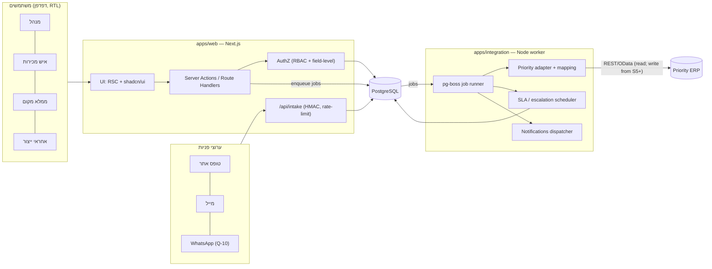
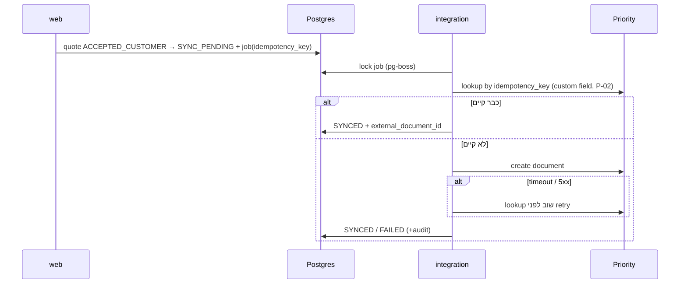

# ארכיטקטורה — Yuval Control

מצב: **אושר בתנאי (D-14, D-15)**. הזדהות לפי A-02. ה-mock של Priority הוא ברירת המחדל היחידה עד אישור נפרד.

## עקרונות
1. **Priority היא מקור האמת** להזמנות, פקודות עבודה, תעודות משלוח וחשבוניות. Yuval Control מחזיקה מראה (mirror) לקריאה ואת המידע שהיא עצמה מנהלת: פניות, הזדמנויות, הצעות, אישורים, האצלות ו-SLA.
2. **רק שירות האינטגרציה מדבר עם Priority.** אפליקציית ה-web לא מחזיקה credentials של Priority (S-03).
3. **כל כתיבה ל-Priority עוברת בתור עבודות**, עם `idempotency_key`, בדיקת קיום לפני ניסיון חוזר (P-02), ותיעוד ב-audit.
4. **הרשאות נאכפות בשרת**, ברמת משאב וברמת שדה (S-02).
5. **לוגיקה עסקית טהורה** (מכונות מצב, תמחור, SLA) נמצאת בחבילת `domain`, בלי תלות ב-DB או ב-UI, כך שאפשר לבדוק אותה ביחידה.

## תרשים רכיבים



## זרימת כתיבה ל-Priority (Sprint 5+)



## מבנה תיקיות מוצע (pnpm workspaces)

```
dz-factory-os-ai/
├── apps/
│   ├── web/                 # Next.js (App Router), UI + Server Actions, RTL
│   │   ├── app/(auth)/ app/(dashboard)/s01..s12/
│   │   ├── components/ui/   # shadcn/ui (קוד מקומי)
│   │   └── lib/authz/       # בדיקות הרשאה ומיסוך שדות
│   └── integration/         # Node worker: pg-boss, Priority adapter, SLA, התראות
│       ├── src/jobs/ src/priority/ src/sla/
│       └── test/fixtures/   # תגובות Priority מוקלטות/מדומות (ללא מערכת חיה)
├── packages/
│   ├── db/                  # Prisma schema, migrations, seed (dev בלבד)
│   ├── domain/              # מכונות מצב, תמחור, SLA, idempotency — TS טהור
│   ├── priority-client/     # typed client + mock server לפי חוזה
│   └── config/              # tsconfig, eslint, prettier משותפים
├── docs/                    # מסמכי שלב 0 (זה)
├── scripts/                 # בדיקות עקביות מסמכים וכלים
└── docker-compose.yml       # Postgres מקומי לפיתוח בלבד (Sprint 1)
```

## סביבות
| סביבה | DB | Priority | הערה |
|---|---|---|---|
| local | Postgres ב-Docker | mock (`priority-client/mock`) | ברירת מחדל |
| staging | Postgres מנוהל | **סביבת בדיקה של Priority בלבד** (Q-06) | נפתחת ב-Sprint 4 |
| production | מנוהל + גיבויים (Q-11) | חיה, קריאה בלבד עד Sprint 5 | **לא בשלב 0** |

אירוח (Vercel, Azure או שרת מקומי) עדיין לא הוכרע (Q-12). ה-worker צריך תהליך שרץ ברציפות, ולכן הוא לא יכול לרוץ כפונקציית serverless.
