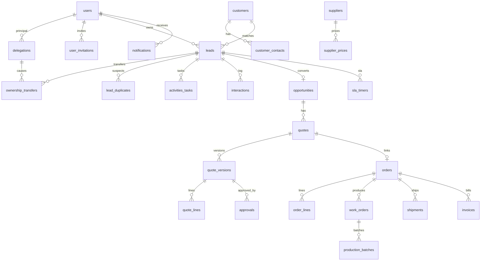
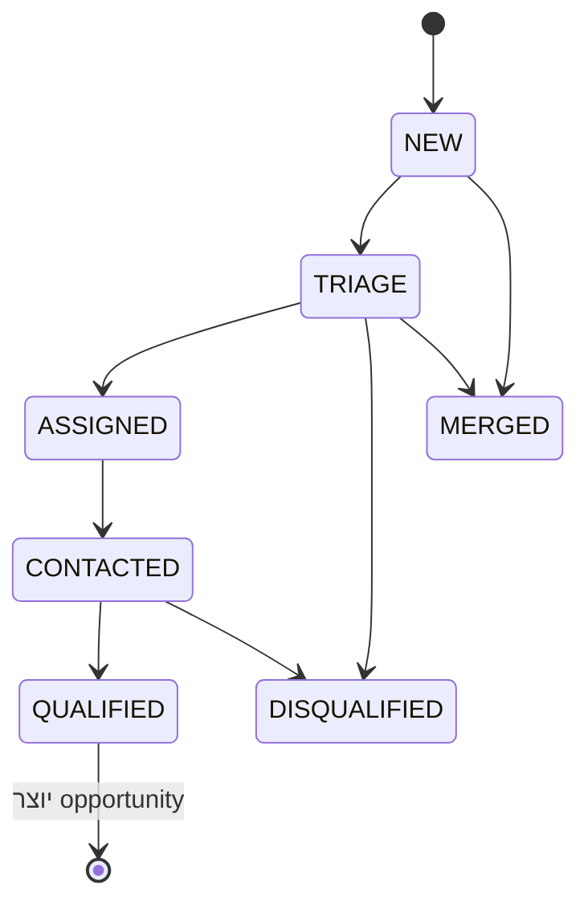
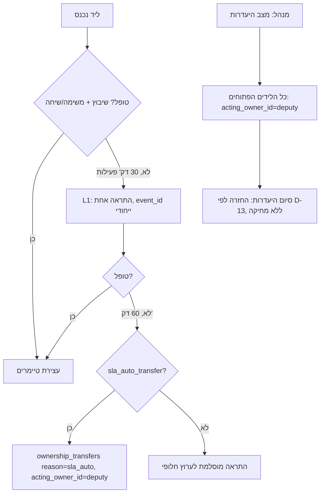

# מודל נתונים — לאחר PHASE-0-FIX

מקרא: **[spec]** ישות מהאפיון v11 · **[A-xx]** שינוי שאושר ב-[08-approved-amendments.md](08-approved-amendments.md) · **[+R-xx]** תוספת שמוצעת בביקורת ועדיין לא אושרה במפורש · **[mirror]** מראה לקריאה בלבד מ-Priority.

מוסכמות:
- מפתחות `uuid`.
- זמנים ב-`timestamptz` (UTC).
- סכומים ב-`numeric(14,2)` עם `currency`.
- לכל טבלה `created_at` ו-`updated_at`.
- ב-CRM לא מוחקים רשומות פיזית (מחיקה רכה או `MERGED`).

> זה מסמך תכנון. **לא נכתב `schema.prisma` ולא בוצעה מיגרציה.**

| ישות | מקור | שדות עיקריים / אילוצים |
|---|---|---|
| users | [spec][A-02] | id, name, email UNIQUE, role_id, active, priority_user_ref, mfa_enabled, deactivated_at |
| auth_sessions / auth_accounts / auth_verifications / two_factors | [A-02] | טבלאות Better Auth. sessions עם expires_at. סיסמה ו-TOTP כ-hash בלבד |
| user_invitations | [A-02] | id, email, role_id, token_hash UNIQUE, invited_by, expires_at, used_at |
| login_attempts | [A-02] | id, email_normalized, ip, success, at; אינדקס (email_normalized, at) |
| roles_permissions | [spec][A-02][A-07] | role_id, resource, action, scope ∈ {own,team,all}, requires_mfa; UNIQUE(role_id,resource,action) |
| delegations | [spec][A-09] | id, principal_id, deputy_id, start_at, end_at, manual_enabled, reason, ended_at; CHECK end_at > start_at |
| ownership_transfers | [A-09] | id, lead_id, original_owner_id, acting_owner_id, transferred_at, reason ∈ {manual_absence,sla_auto}, delegation_id?, event_id UNIQUE, returned_at |
| customers | [spec][A-01] | id, priority_customer_id UNIQUE NULL, legal_name, business_id UNIQUE NULL (תקין בלבד), business_id_raw, phone_normalized, email_normalized, merged_into_id? |
| customer_contacts | [+R-09] | id, customer_id, name, phone_normalized, email_normalized, role, marketing_consent_at |
| leads | [spec][A-01][A-05][A-09] | id, source, source_event_id UNIQUE, customer_id?, original_owner_id, acting_owner_id?, status (NEW..QUALIFIED/DISQUALIFIED/MERGED), priority, customer_match ∈ {exact,suspected,none}, business_id, business_id_raw, phone_normalized, email_normalized, next_action_at, last_contact_at, handled_at, merged_into_id? |
| lead_duplicates | [A-01] | id, lead_id, candidate_lead_id?, candidate_customer_id?, match_rule ∈ {business_id,phone,email}, resolution ∈ {pending,linked,merged,dismissed}, resolved_by, resolved_at |
| activities_tasks | [spec][A-09] | id, lead_id?, opportunity_id?, assigned_to, due_at, completed_at, completed_by, outcome |
| interactions | [+R-09] | id, customer_id?, lead_id?, opportunity_id?, channel, direction, summary, actor_id, at |
| opportunities | [spec][A-05][+R-05] | id, lead_id UNIQUE, customer_id, source, owner_id, stage (QUOTED..WON/LOST), expected_value, expected_margin, lost_reason_code, lost_reason_note |
| quotes | [spec][A-06] | id, opportunity_id, origin ∈ {internal,priority}, priority_quote_id UNIQUE NULL, current_version_id, status, currency, valid_until, sync_state, external_document_id, external_version, idempotency_key UNIQUE, link_verified_at; CHECK status<>'SYNCED' OR link_verified_at IS NOT NULL |
| quote_versions | [A-03] | id, quote_id, version, source ∈ {internal,priority}, snapshot jsonb, snapshot_hash, cost_confidence, created_by, locked_at; UNIQUE(quote_id,version); trigger חוסם UPDATE כש-locked_at אינו NULL |
| quote_lines | [spec][A-03][+R-10][+R-20] | id, quote_version_id, item_ref, qty, parts_count, sqm, uom, ral, complexity, list_price, extras, discount, vat_rate, estimated_cost, cost_confidence |
| approvals | [spec][A-03] | id, quote_version_id, requested_by, approved_by, reason, decision, valid_until, timestamp |
| items | [+R-03][mirror] | id, priority_part_name UNIQUE, description, uom, type |
| orders | [A-04][mirror] | id, priority_order_id UNIQUE, customer_id, quote_id?, status, last_synced_at |
| order_lines | [A-04][mirror] | id, order_id, item_id, qty, shipped_qty, invoiced_qty |
| work_orders | [spec][mirror] | id, priority_wo_id UNIQUE, order_id, planned_qty, status, last_synced_at |
| resources | [+R-03] | id, name, kind |
| production_batches | [spec][+R-06] | id, work_order_id, qty, good_qty, rejected_qty, ral, resource_id, stage, timestamps |
| shipments | [spec][mirror] | id, priority_delivery_id UNIQUE, order_id, shipped_qty, status |
| invoices | [+R-06][mirror] | id, priority_invoice_id UNIQUE, order_id, invoiced_qty, total |
| suppliers | [+R-03] | id, name, priority_supplier_id? |
| supplier_prices | [spec] | id, supplier_id, powder_sku, price_kg, moq, lead_time_days, valid_from, valid_to |
| sla_timers | [A-09] | id, lead_id, level ∈ {L1,L2}, cycle, due_at, fired_at; UNIQUE(lead_id,level,cycle) |
| business_calendar | [A-09] | date, open_time, close_time, is_holiday |
| notifications | [spec][A-09] | id, user_id, event_id, channel, due_at, acknowledged_at; UNIQUE(event_id,user_id,channel) |
| integration_jobs | [spec] | id, entity, external_id, direction, state, retries, payload_hash, idempotency_key UNIQUE, last_error |
| attachments | [+R-09] | id, entity, entity_id, storage_key, mime, size, sha256 |
| audit_events | [spec][+S-05] | id, actor_id, entity, entity_id, action, before_after (ממוסך), created_at — append-only |
| settings | [+R-19] | key, value jsonb (ספי SLA, sla_auto_transfer, ערכי אבטחה, מינימום מחיר) |

## ERD (ליבה)

## מכונות מצב (A-05, A-06)

- **opportunity:** QUOTED → NEGOTIATION → WON | LOST (חובה `lost_reason_code`).
- **quote:** DRAFT → REVIEW → APPROVED_INTERNAL → SENT → ACCEPTED_CUSTOMER → SYNC_PENDING → SYNCED (רק עם `link_verified_at`) → ORDER_LINKED; | REJECTED | EXPIRED. שינוי במחיר, כמות, מפרט, גוון או תנאי אספקה יוצר גרסה חדשה וחזרה ל-DRAFT.

## זרימת SLA והיעדרות (A-09)

