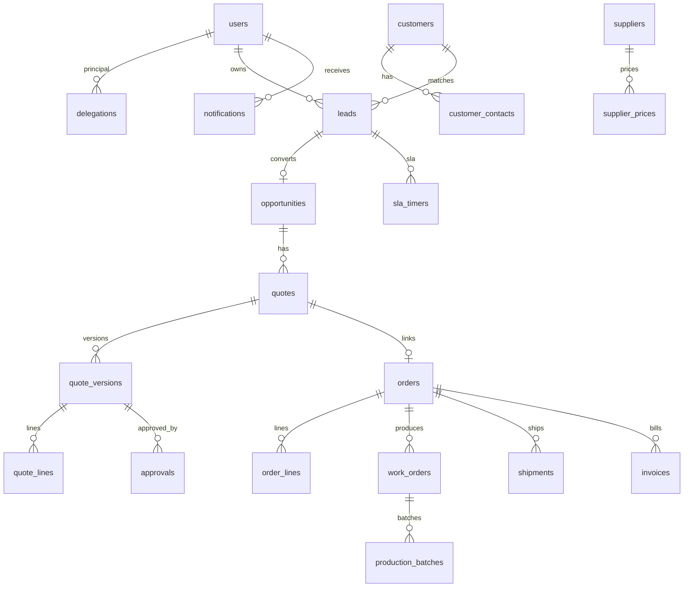

# מודל נתונים — הצעה

מקרא: **[spec]** ישות מהאפיון v11 · **[+R-xx]** תוספת שמוצעת בביקורת · **[mirror]** מראה לקריאה בלבד מ-Priority.
מוסכמות: מפתחות `uuid`. זמנים ב-`timestamptz` (UTC). סכומים ב-`numeric(14,2)` עם `currency`. לכל טבלה `created_at`/`updated_at`. מחיקה רכה (`deleted_at`) רק בישויות CRM.

> זו הצעה תיעודית. **לא נכתב `schema.prisma` ולא בוצעה מיגרציה.** הסכמה תיכתב ב-Sprint 1 לאחר אישור.

| ישות | מקור | שדות עיקריים / אילוצים |
|---|---|---|
| users | [spec][+R-11] | id, name, email UNIQUE, role_id, active, priority_user_ref, mfa_enabled |
| roles_permissions | [spec][+R-11] | role_id, resource, action, scope ∈ {own,team,all}; UNIQUE(role_id,resource,action) |
| delegations | [spec] | id, principal_id, deputy_id, start_at, end_at, manual_enabled, reason; CHECK end_at > start_at |
| customers | [spec][+R-04] | id, priority_customer_id UNIQUE NULL, legal_name, business_id (מנורמל, אינדקס), phone_normalized, email_normalized |
| customer_contacts | [+R-09] | id, customer_id, name, phone, email, role, marketing_consent_at |
| leads | [spec][+R-04][+R-07] | id, source, customer_id?, owner_id, acting_owner_id?, status (NEW..QUALIFIED/DISQUALIFIED), priority, customer_match, business_id, next_action_at, last_contact_at, created_at |
| lead_duplicates | [+R-04] | id, lead_id, candidate_lead_id/customer_id, match_rule, resolution, resolved_by |
| activities_tasks | [spec] | id, lead_id?, opportunity_id?, assigned_to, due_at, completed_at, outcome |
| interactions | [+R-09] | id, customer_id, lead_id?, opportunity_id?, channel, direction, summary, at |
| opportunities | [spec][+R-05][+R-12] | id, customer_id, lead_id, source, owner_id, stage (QUOTED..WON/LOST), expected_value, expected_margin, lost_reason_code, lost_reason_note |
| quotes | [spec] | id, opportunity_id, priority_quote_id?, current_version_id, status, currency, valid_until, sync_state, external_document_id, external_version, idempotency_key UNIQUE |
| quote_versions | [+R-01] | id, quote_id, version, snapshot jsonb (immutable), cost_confidence, created_by; UNIQUE(quote_id,version) |
| quote_lines | [spec][+R-10][+R-20] | id, quote_version_id, item_ref, qty, parts_count, sqm, uom, ral, complexity, list_price, extras, discount, vat_rate, estimated_cost, cost_confidence |
| approvals | [spec] | id, quote_version_id, requested_by, approved_by, reason, decision, valid_until, timestamp |
| items | [+R-03][mirror] | id, priority_part_name UNIQUE, description, uom, type (powder/service/…) |
| orders / order_lines | [+R-02][mirror] | id, priority_order_id UNIQUE, customer_id, quote_id?, status, last_synced_at / qty, invoiced_qty |
| work_orders | [spec][mirror] | id, priority_wo_id UNIQUE, order_id, planned_qty, status, last_synced_at |
| resources | [+R-03] | id, name, kind (תחנה/תנור/קו) |
| production_batches | [spec][+R-06] | id, work_order_id, qty, good_qty, rejected_qty, ral, resource_id, stage, timestamps |
| shipments | [spec][mirror] | id, priority_delivery_id UNIQUE, order_id, shipped_qty, status |
| invoices | [+R-06][mirror] | id, priority_invoice_id UNIQUE, order_id, invoiced_qty, total |
| suppliers | [+R-03] | id, name, priority_supplier_id? |
| supplier_prices | [spec] | id, supplier_id, powder_sku, price_kg, moq, lead_time_days, valid_from, valid_to |
| sla_timers | [+R-08] | id, lead_id, level, due_at, fired_at; UNIQUE(lead_id,level) |
| business_calendar | [+R-09] | date, open_time, close_time, is_holiday |
| notifications | [spec][+R-08] | id, user_id, event_id UNIQUE, channel, due_at, acknowledged_at |
| integration_jobs | [spec] | id, entity, external_id, direction, state, retries, payload_hash, idempotency_key UNIQUE, last_error |
| attachments | [+R-09] | id, entity, entity_id, storage_key, mime, size, sha256 |
| audit_events | [spec][+S-05] | id, actor_id, entity, entity_id, action, before_after (ממוסך), created_at — append-only |
| settings | [+R-19] | key, value jsonb (ספי SLA, מינימום מחיר, ספי חריגה) |

## ERD (ליבה)

## מכונות מצב (יוגדרו בקוד ב-`packages/domain`)
- **lead:** NEW → TRIAGE → ASSIGNED → CONTACTED → QUALIFIED (המרה להזדמנות) | DISQUALIFIED · לפי R-12.
- **opportunity:** QUOTED → NEGOTIATION → WON | LOST(+reason).
- **quote:** DRAFT → REVIEW → APPROVED_INTERNAL → SENT → ACCEPTED_CUSTOMER → SYNC_PENDING → SYNCED → ORDER_LINKED; | REJECTED | EXPIRED. שינוי במחיר, כמות, מפרט, גוון או תנאי אספקה יוצר `quote_version` חדשה ומחזיר את ההצעה ל-DRAFT.
