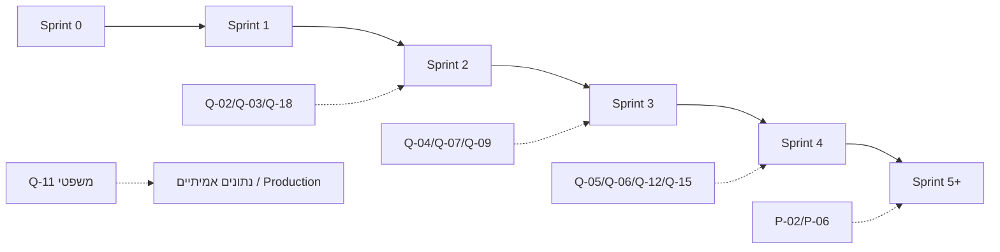

# תוכנית ספרינטים ותנאי קבלה מדידים

עודכן ב-PHASE-0-FIX לפי התלויות בפועל. אורך הספרינטים ייקבע לאחר הערכת מאמץ (סעיף 10 באפיון).
התיקונים המחייבים: [08](08-approved-amendments.md). מקרי הבדיקה: [10](10-test-cases.md).

**כללים לכל הספרינטים (Definition of Done):**
- `pnpm lint`, `pnpm typecheck` ו-`pnpm test` עוברים ב-CI על ה-commit האחרון.
- כיסוי בדיקות ≥ 90% לקוד ב-`packages/domain`.
- אין פגיעויות High או Critical ב-`pnpm audit --prod`.
- לכל מעבר מצב ולכל שינוי הרשאה נכתבת רשומה ב-`audit_events`.
- אין קריאה לסביבת Priority חיה. אין מיגרציה ל-DB שאינו מקומי או staging מאושר. אין משתמשי Production.

## תלויות

## Sprint 0 — שלב 0 (הנוכחי)
- [x] בדיקת הריפו, הסביבה, ביקורת, ארכיטקטורה, מודל, גרסאות, תוכנית
- [x] PHASE-0-FIX: החלטות D-01..D-17, תיקונים A-01..A-09, מקרי בדיקה
- [x] בדיקת התקנה בפועל של הסטאק (V7)
- [ ] אישור מפורש של בעל המפעל לסגירת שלב 0 (AC0.3)

תנאי קבלה:
- **AC0.1** — `node scripts/check-docs.mjs` מסתיים בקוד 0.
- **AC0.2** — לכל שאלה וסיכון חוסמים יש בעלים ומועד יעד (נבדק בסקריפט).
- **AC0.3** — אישור בכתב של בעל המפעל על המסמכים, על הסטאק ועל סגירת R-04 ו-S-01.
- **AC0.4** — install, build, typecheck ו-lint עוברים על הגרסאות הנעולות בפרויקט ניסיון מבודד, בלי DB ובלי Priority.

## Sprint 1 — משתמשים, הזדהות, הרשאות, תיבת פניות, שיבוץ (S02, S11 חלקי)
משימות:
- scaffolding של המונוריפו
- Postgres מקומי ב-docker-compose
- Prisma schema ל: users, auth_*, user_invitations, login_attempts, roles_permissions, customers, customer_contacts, leads, lead_duplicates, interactions, activities_tasks (בסיס), audit_events, settings
- Better Auth לפי A-02
- RBAC ו-DTO לפי A-02 ו-A-07
- קליטה ב-`/api/intake` מטופס אתר ומייל
- זיהוי כפילויות ומיזוג לפי A-01
- שיבוץ אחראי
- seed עם נתוני דוגמה בלבד

תנאי קבלה:
- **AC1.1** — build נקי של `apps/web` ושל `apps/integration` עם הגרסאות הנעולות.
- **AC1.2** — `prisma migrate dev` על DB מקומי ריק. `migrate reset` חוזר על עצמו בלי שגיאות.
- **AC1.3** — TC-DUP-01..11 עוברים (UAT 1).
- **AC1.4** — TC-AUTH-10/11/12: מטריצת הרשאות מלאה בשרת, ו-0 דליפות של שדות חסויים.
- **AC1.5** — TC-AUTH-01..09 ו-TC-AUTH-13: אין הרשמה ציבורית, יש הזמנה, MFA, איפוס, נעילה, ביטול גישה ותפוגה.
- **AC1.6** — `/api/intake` דוחה בקשה בלי HMAC תקין (401) ומגביל קצב (429).
- **AC1.7** — שיבוץ מעדכן `original_owner_id` ו-status=ASSIGNED, עם audit. ≤ 3 קליקים מהתיבה (Playwright).

## Sprint 2 — משימות, היעדרות, SLA, התראות, דשבורד CRM (S01 חלקי, S04 משימות)
דרישה מוקדמת: Q-02, Q-03 ו-Q-18 (אפשר לפתוח עם ברירות המחדל ולהחליף אחר כך, אבל לא לעלות לאוויר).
- **AC2.1** — TC-DEL-01/02 (UAT 2).
- **AC2.2** — TC-DEL-03..07: התראה אחת לכל דרגה, ללא כפילות גם עם 2 workers (UAT 3).
- **AC2.3** — TC-DEL-09/10: הגדרת "טופל".
- **AC2.4** — TC-DEL-08: שעות פעילות.
- **AC2.5** — TC-DEL-11/12: החזרה בסיום היעדרות, ללא אובדן נתונים.
- **AC2.6** — הדשבורד כולל ווידג'טים של CRM בלבד (A-08). p95 < 1.5 שניות עם 10,000 לידים ב-seed.

## Sprint 3 — הזדמנויות, הצעות פנימיות, גרסאות, אישורים (S04, S05, S06)
דרישה מוקדמת: Q-04, Q-07, Q-09.
- **AC3.1** — UAT 4: שינוי בהצעה מאושרת יוצר `quote_version` חדשה וחזרה ל-DRAFT. ניסיון UPDATE לגרסה נעולה נחסם ב-DB (A-03).
- **AC3.2** — כל מעבר לא חוקי במכונות המצב של ליד, הזדמנות והצעה נדחה (property-based). אין סטטוס QUOTED או WON על ליד (A-05).
- **AC3.3** — מחשבון: ≥ 20 מקרים מאושרים זהים עד אגורה. מינימום מחיר נאכף.
- **AC3.4** — UAT 7: חובה `lost_reason_code`. שיעור סגירה לפי מקור.
- **AC3.5** — תווית `cost_confidence` מוצגת. deputy ו-sales לא רואים רווח (TC-AUTH-11).
- **AC3.6** — מעבר ל-SYNC_PENDING יוצר job עם `idempotency_key`. **אין מעבר ל-SYNCED** בלי `link_verified_at`, ונבדק גם ב-CHECK ב-DB (A-06).

## Sprint 4 — חיבור קריאה בלבד, ייבוא הצעות Priority, דוחות (S03, S07, S08, S09, S10, S12, S01 מלא)
דרישה מוקדמת: Q-05, Q-06, Q-12, Q-15, ואישור נפרד לגישה לסביבת **בדיקה** (D-15).
- **AC4.1** — סנכרון קריאה של customers, orders, order_lines, work_orders, shipments ו-invoices. סטייה של 0 רשומות בדגימה.
- **AC4.2** — סנכרון idempotent: הרצה חוזרת לא משנה רשומות (hash).
- **AC4.3** — UAT 6: ייוצר, תקין, נשלח, חויב ויתרה ≥ 0.
- **AC4.4** — S12 מציג כשלים. ניסיון חוזר ידני מוגבל ומתועד.
- **AC4.5** — אין נתיב כתיבה ל-Priority בקוד (סריקת POST, PATCH ו-DELETE).
- **AC4.6** — ייבוא הצעות `origin=priority` לקריאה בלבד, עם גרסה חדשה לכל שינוי. מסמך שכבר מקושר לא יוצר הצעה כפולה (A-06).
- **AC4.7** — אימות קישור: `link_verified_at` נקבע רק לאחר קריאה תואמת. הצעות SYNC_PENDING עם קישור תקין עוברות ל-SYNCED.
- **AC4.8** — ווידג'טים של Priority נוספים לדשבורד S01 (A-08).

## Sprint 5+ — כתיבה מבוקרת, ייצור ורווחיות, אתר ומדיה
דרישה מוקדמת: P-02 (שדה idempotency ב-Priority), P-06, ואישור מוסמך.
- **AC5.1** — UAT 5: timeout אחרי יצירה (mock ובדיקה) מייצר בדיוק מסמך אחד.
- **AC5.2** — כתיבה רק מ-ACCEPTED_CUSTOMER עם מיפוי תקין. אחרת הכתיבה נכשלת בלי קריאה ל-Priority.
- **AC5.3** — Production רק באישור מפורש, אחרי Q-11 ובדיקת גיבוי ושחזור.
